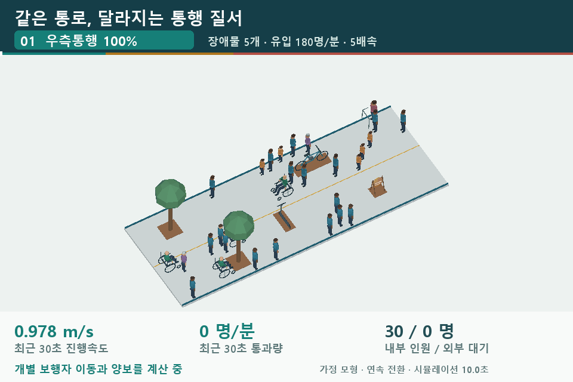

**사람의 이동과 혼잡을 살펴보는 소규모 공간 3D 실험실**  
A browser-based 3D laboratory for pedestrian flow and small-space design.

보행 통로, 시내버스, 엘리베이터, 계단에서 사람의 이동과 공간 점유를 시각화합니다. 유입량·통행 방향·장애물·운영 방식·공간 치수를 바꾸며 속도, 밀도, 대기와 승하차 차이를 살펴볼 수 있습니다.

HTML·CSS·JavaScript로 구성된 정적 웹 앱입니다. 계산과 3D 표시는 브라우저 안에서 실행하며, 별도의 백엔드 없이 GitHub Pages에 게시할 수 있습니다.

## 데모

> 게시 후 아래 `YOUR_USERNAME`을 GitHub 계정명으로 바꾸세요. 저장소 이름을 `microspace-lab`과 다르게 정했다면 그 부분도 바꿔주세요.

| 실험 | 데모 URL | 주요 기능 |
| --- | --- | --- |
| 전체 안내 | https://YOUR_USERNAME.github.io/microspace-lab/ | 네 가지 실험 소개 |
| 보행 인파 | https://YOUR_USERNAME.github.io/microspace-lab/crowd/ | 유입량·통행 규칙·장애물에 따른 이동과 혼잡 |
| 시내버스 | https://YOUR_USERNAME.github.io/microspace-lab/bus/ | 앞쪽 체류·실내 분산·반복 승하차·현재 탑승 인원 |
| 엘리베이터 | https://YOUR_USERNAME.github.io/microspace-lab/elevator/ | 진입 방향·목적층별 자리 안내·임시 하차와 재탑승 |
| 계단 배치 | https://YOUR_USERNAME.github.io/microspace-lab/stairs/ | 공간 치수별 U자·회전계단, 1~5명 상·하행 |

각 실험은 고유한 하위 경로를 사용하므로 개별 URL로 공유할 수 있습니다.

## 보행 인파 미리보기

**54초 · 960×640 · 5배속 · 약 5.6MB**

장애물 5개와 유입량 180명/분을 유지하면서 **우측통행 100% → 5% 반대편 선택 → 무작위 통행**으로 차례로 전환합니다. 같은 사람과 점유 상태를 이어 계산하며, 마지막 정체를 강제로 정지시켜 연출하지 않았습니다.

이 GIF는 통행 규칙 전환과 혼잡 누적을 함께 보여주는 **가정 시나리오**입니다. 무작위 통행이 실제 모든 공간에서 같은 결과를 낸다는 뜻은 아닙니다. 웹 앱의 독립 조건 비교와 GIF의 연속 전환 시나리오는 구별해야 합니다.

## 주요 기능

### 보행 인파

- 어린이·성인·고령자·보행보조기 이용자·휠체어 이용자 모형.
- 유입량을 바꿔도 기존 사람·대기열·경과 시간을 유지하는 연속 시뮬레이션.
- 우측통행 100%, 5% 반대편 선택, 무작위 통행 비교.
- 가로수·킥보드·자전거·입간판 배치와 병목 실험.
- 최근 최대 30초의 통행량·진행속도·평균 밀도 표시.

### 시내버스

- 앞쪽 좌우 1인석, 뒤쪽 좌우 2인석, 맨뒤 5인석을 둔 가상 실내.
- 기본 47명: 착석 23명 + 입석 24명.
- 6회 정차에서 반복 승하차하며, 주행 2초와 정류장 승하차를 구분.
- 현재 총 탑승 인원, 앞·뒤 인원, 앞쪽 체류와 분산 운영 비교.

### 엘리베이터

- 8·13·15인승 규격 예시와 탑승 인원 조절.
- 무작위 혼합, 진입 방향 안내만, 방향+목적층 배치의 3조건 동시 시각화.
- 저층 목적자의 하차, 앞사람의 임시 하차·재탑승과 소요 시간 비교.
- 오른쪽 대기·하차 우선·고층부터 안쪽 탑승·저층은 문 가까이 배치하는 안내 예시.

### 계단 배치

- 가로·세로·층고·목표 유효폭에 따른 U자·회전계단 기하학 비교.
- 단높이·디딤폭·경사도·유효폭과 중앙 난간 표시.
- 1~5명의 상행·하행·양방향 통행.
- 넓은 U자는 우측 두 줄, 좁은 U자와 회전계단은 보수적으로 한 명씩 교대 진입.

## GitHub Pages 게시

1. 이 `README.md`와 `index.html`이 있는 폴더의 **내용 전체**를 저장소 루트에 올립니다.
2. **Settings → Pages → Build and deployment → Source**에서 **Deploy from a branch**를 선택합니다.
3. **main / (root)**를 선택하고 저장합니다.
4. 게시된 주소와 `/crowd/`, `/bus/`, `/elevator/`, `/stairs/`를 각각 열어 확인합니다.

배포 패키지에서 가져왔다면 `github` 폴더의 **내용**을 업로드하세요. `backup` 폴더는 개발 소스·원본 데이터·검증 기록 보관용입니다. 게시를 위해 Python·Node.js를 설치하거나 서버 프로그램을 실행할 필요는 없습니다.

| 파일·폴더 | 역할 |
| --- | --- |
| `index.html` | 실험 안내 페이지 |
| `crowd/`, `bus/`, `elevator/`, `stairs/` | 개별 실험 진입 페이지 |
| `assets/app.js`, `assets/app.css` | 공통 모형·뷰어·스타일 |
| `assets/crowd-preview.gif` | 최신 홍보 GIF |
| `assets/preview.png` | 미리보기 이미지 |
| `.nojekyll` | 정적 파일 게시 설정 |

## 조작

- **드래그:** 3D 시점 회전 · **마우스 휠:** 확대·축소.
- **재생/일시정지:** 이동 장면 제어.
- **보행 유입 슬라이더:** 앞으로 도착할 인원 변경. 최근 30초 지표에는 변경 전후가 섞일 수 있습니다.
- **장애물 편집:** 바닥을 짧게 클릭해 추가·선택·이동·삭제하고 변경 배치를 적용합니다.
- **결과 저장:** 현재 실험의 계산 결과를 JSON으로 내려받습니다.

## 모형과 해석 범위

이 프로젝트는 **설명·설계 검토를 위한 가정 모형**입니다.

- 보행은 격자 점유·경로 탐색, 버스·엘리베이터는 경로와 점유 예약, 계단은 기하학과 이동 경로를 단순화해 계산합니다.
- 실제 관측 자료로 보정한 이동·사고 예측 모형이 아닙니다. 접촉압·낙상·급정거·구조 안전·피난 성능은 판정하지 않습니다.
- 공간 치수와 정원은 규격 예시 또는 가정입니다. 법정 정원·무장애 설계·현행 법규 적합은 별도 검토가 필요합니다.
- 정량 결과는 유입량·이용자 구성·난수·장애물·양보 규칙과 측정 시간에 따라 달라집니다.
- 공개본의 UI/실제 Worker 검사, 네 경로의 초기 진입, 상대 링크와 GIF를 확인했습니다. 실제 GitHub 배포·브라우저 픽셀 배치·GPU 드라이버·장시간 성능 검사는 별도입니다.

원본 소스와 상세 검증 기록은 배포 패키지의 `backup` 폴더에 보관합니다. 공통 공개 스크립트는 초기화에만 쓰이는 과거 궤적을 줄여 경량화했으며, 현재 실시간 모형은 유지합니다.

## 참고

- [GitHub Pages 소개](https://docs.github.com/en/pages/getting-started-with-github-pages/what-is-github-pages)
- [GitHub Pages 게시 원본 설정](https://docs.github.com/en/pages/getting-started-with-github-pages/configuring-a-publishing-source-for-your-github-pages-site)
